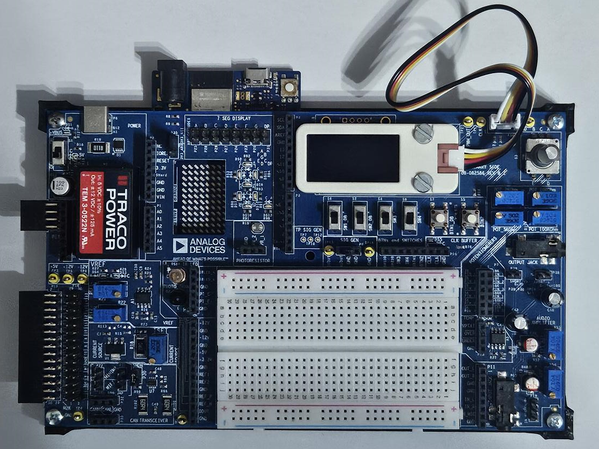
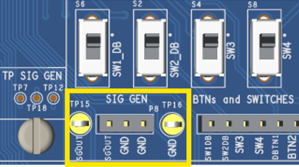
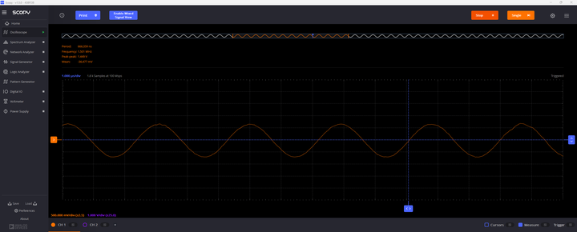
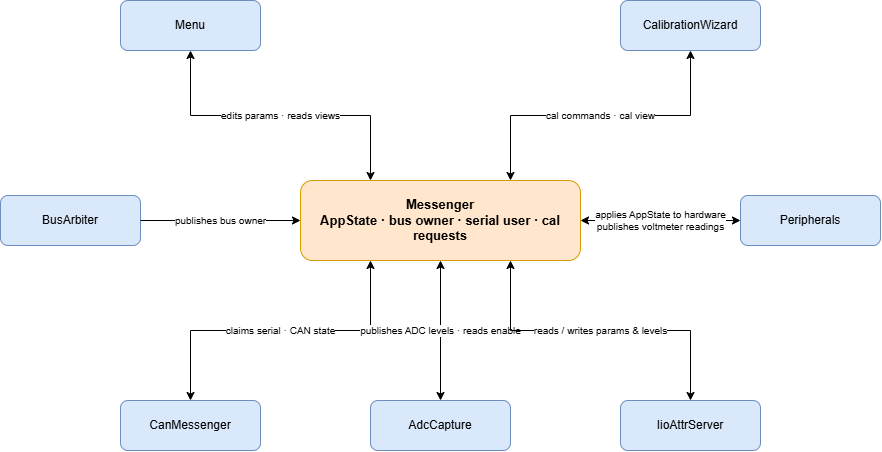

# AD-M2KCOMPEDU-EBZ Firmware

Arduino firmware for the AD-M2KCOMPEDU-EBZ, an educational add-on board for the ADALM2000. It has a signal generator (sine, square, triangle, DC) with adjustable amplitude, frequency, and DC offset, and a PWM generator with adjustable frequency and duty cycle. Both can also be controlled remotely over the USB port using [libiio](https://github.com/analogdevicesinc/libiio).



A Python demo panel that exercises the motor-control (CAN), signal-generator (IIO) and ADC-capture features from a single GUI lives in [demos/](demos/README.md).

# Example Usage

Make sure that your board has the firmware uploaded, if not see the [Building and Flashing the board](#building-and-flashing-the-board) section

## Generating a wave

1. Connect the power supply in the USB-C power port of the board and move the Power Switch to the on position.
2. Using the rotary encoder navigate to Signal Gen -> WaveForm (you can select DC, Sine, Square or Triangle). Then select the peak-to-peak amplitude, frequency and offset

    

3. You can view the resulting waveform by connecting a scope to any of the SGOUT test points or header. As a ground reference you can use any of the test points or headers labeled as GND

      
    

## Generating a PWM signal

1. Connect the power supply in the USB-C power port of the board and move the Power Switch to the on position.
2. Using the rotary encoder navigate to PWM Gen -> PWM Out set to On. Then you can select Frequency and Duty Cycle

    

3. You can view the resulting PWM signal by connecting a scope to any of the CLK labeled test points or header. As a ground reference you can use any of the test points or headers labeled as GND

       
    

## Calibration System

Three procedures correct for component tolerances. Each is a step-by-step wizard: press advances steps, rotate adjusts values. Results are stored in EEPROM at address `0x10`.

### Offset Calibration

Corrects the DC offset zero-point by adjusting the `calOffset` trim.

1. **Press** to start: firmware switches the output off with offset 0 V. The OLED prompts to connect a voltmeter to the signal output
2. **Rotate** to adjust the trim until the voltmeter reads 0 V
3. **Press** to store: the new trim value is saved to EEPROM

### Sine Amplitude Calibration

Corrects sine amplitude gain at two reference points:

1. **Press** to start: firmware sets Sine, 1 KHz, 1 Vpp, DC = 0 V
2. **Rotate** to adjust the `calSine1V` trim until scope reads exactly 1 Vpp
3. **Press** to advance: amplitude changes to target 10 Vpp
4. **Rotate** to adjust the `calSine10V` trim until scope reads exactly 10 Vpp
5. **Press** to store

### Square Wave Amplitude Calibration

Same procedure as sine calibration, but adjusts the `calSqw1V` / `calSqw10V` trims.

## ADC Capture

Pins A2 (pre-amp) and A3 (post-amp) are sampled at 8 kHz with 14-bit resolution by a timer ISR using ping-pong double buffering (256 samples per channel per block).

ADC streaming, IIO and CAN/SLCAN all share the same serial port, so only one can be active at a time — the firmware's bus arbiter handles the switching.

To start streaming, navigate to **ADC Monitor** on the OLED and press the encoder. While the monitor is open, every completed capture block is written to the USB serial port as one binary frame. Long-press the encoder to stop streaming and exit.

### Serial output format

Each frame on the serial port is formed as:

```
0xAA 0x55 <channels:1> <ch1:256×int16> [<ch2:256×int16>]
```

- `0xAA 0x55` — sync bytes marking the start of a frame
- `channels` — one byte, `1` or `2`, the number of channel blocks that follow
- each channel block is 256 consecutive samples, **little-endian signed 16-bit**, channel 1 (A2, pre-amp) first, then channel 2 (A3, post-amp)
- samples are raw ADC counts; convert to volts with `V = raw × 5.0 / 16383`

At 8 kHz a frame covers 32 ms of signal, so expect ~31 frames per second per channel.

### Reading ADC levels via IIO

Once you exit ADC Monitor (long-press), serial switches back to IIO and you can query the last captured levels:

```
iio_attr -u serial:/dev/ttyACM0,921600,8n1 -c m2kcompedu-ebz -i voltage2 raw
```

You can also start/stop capture remotely without the OLED menu:

```
iio_attr -u serial:/dev/ttyACM0,921600,8n1 -c m2kcompedu-ebz -i voltage2 enable 1
```

## CAN Messenger

The firmware can act as a USB-to-CAN adapter speaking the slcan (LAWICEL) ASCII protocol on the USB serial port. CAN shares pins with the signal-generator SPI bus: install the two CAN jumpers (P21 and P22) and the firmware detects CAN mode and automatically routes the serial port to the slcan bridge. Remove the jumpers to return the port to IIO. The **CAN Messenger** entry on the OLED shows the bridge state (bitrate, channel open/closed).

Any slcan-capable tool works, e.g. [python-can](https://python-can.readthedocs.io/):

```python
import can
bus = can.Bus(interface="slcan", channel="COM4", bitrate=500000)
```

Supported slcan commands (each terminated with CR; the firmware answers CR for OK, BEL for error):

| Command | Meaning |
|---------|---------|
| `S4` / `S5` / `S6` / `S8` | Set bitrate: 125 k / 250 k / 500 k / 1 M |
| `O` / `L` | Open the CAN channel |
| `C` | Close the CAN channel |
| `tiiiLDD..` | Transmit standard frame (11-bit id, L data bytes) |
| `Tiiiiiiii LDD..` | Transmit extended frame (29-bit id) |
| `Z0` / `Z1` | Timestamps on received frames off / on (16-bit ms) |
| `F` | Read status flags |
| `V` / `N` | Version / serial number |

Received frames are emitted on the serial port in the same `t`/`T` record format.

## Voltmeter

The **Voltmeter** menu on the OLED shows live DC readings of the A2 and A3 inputs (0 – 5 V range). The same readings are available remotely through IIO as the `voltage2` / `voltage3` input channels — `raw` is in millivolts, and `raw × scale` gives volts:

```
iio_attr -u serial:/dev/ttyACM0,921600,8n1 -c m2kcompedu-ebz -i voltage2 raw
iio_attr -u serial:/dev/ttyACM0,921600,8n1 -c m2kcompedu-ebz -i voltage2 scale
```

## Remote control over IIO

The firmware runs an IIOD server over the UART (accessible through the USB port of the Uno R4), so the board can also be controlled remotely with any [libiio](https://github.com/analogdevicesinc/libiio) client instead of the rotary encoder/menu. Connect using the serial backend, at 921600 baud:

```
iio_info -u serial:/dev/ttyACM0,921600,8n1
```

This exposes a single IIO device, `m2kcompedu-ebz`, with output and input channels:

- `altvoltage0` : the signal generator: `wavetype`, `amplitude`, `offset`, `frequency`
- `altvoltage1` : the PWM generator: `enable`, `duty_cycle`, `frequency`
- `voltage2`, `voltage3` : ADC inputs (A2, A3), shared by the voltmeter and ADC capture: `raw`, `scale`, `enable`

`wavetype` selects the signal generator's waveform and is an index into `OFF (0)`, `DC (1)`, `Sine (2)`, `Square (3)`, `Triangle (4)` e.g. the `wavetype value: 2` in the sample below means the generator is producing a sine wave.

`amplitude` and `offset` are raw millivolt (mV) values, e.g. `amplitude value: 2000` is 2000 mV (2 Vpp), and `offset value: 0` is 0 mV.

```
IIO context has 1 devices:
        m2kcompedu-ebz: m2kcompedu-ebz
                4 channels found:
                        altvoltage0:  (output)
                        4 channel-specific attributes found:
                                attr  0: wavetype value: 2
                                attr  1: amplitude value: 2000
                                attr  2: offset value: 0
                                attr  3: frequency value: 1234.000
                        altvoltage1:  (output)
                        3 channel-specific attributes found:
                                attr  0: enable value: 1
                                attr  1: duty_cycle value: 85
                                attr  2: frequency value: 1235.000
                        voltage2:  (input)
                        3 channel-specific attributes found:
                                attr  0: raw value: 2500
                                attr  1: scale value: 0.001000
                                attr  2: enable value: 0
                        voltage3:  (input)
                        3 channel-specific attributes found:
                                attr  0: raw value: 2500
                                attr  1: scale value: 0.001000
                                attr  2: enable value: 0
```

Each attribute can be read or written directly with `iio_attr`, e.g. to set the signal generator frequency to 2 kHz:

```
iio_attr -u serial:/dev/ttyACM0,921600,8n1 -c m2kcompedu-ebz altvoltage0 frequency 2000
```


# Building and Flashing the board

## Arduino IDE

The Arduino IDE does not read the build profile, so libraries must be installed
manually via **Sketch > Include Library > Manage Libraries**. Install the exact
versions below for a build that matches the pinned toolchain:

| Library | Version | Purpose |
|---------|---------|---------|
| `Adafruit SH110X` | 2.1.14 | OLED display driver |
| `Adafruit GFX Library` | 1.12.6 | Graphics primitives (used by SH110X) |
| `Adafruit BusIO` | 1.17.4 | I2C/SPI abstraction (dependency of the Adafruit libraries) |


Then:

1. Open `ad-m2kcompedu-ebz-firmware.ino` in the Arduino IDE

   

2. Install the libraries listed above. In the Library Manager, select the
   package (1), pick the exact version from the dropdown (2), and click
   **Install** (3):

   

3. Install the **Arduino UNO R4 Boards** core, version **1.5.3**, via
   **Tools > Board > Boards Manager** (the version dropdown lets you pick 1.5.3),
   then select **Arduino UNO R4 WiFi** via **Tools > Board**

   

4. Select the correct port via **Tools > Port**
5. Click **Upload** (or Ctrl+U)

## Arduino CLI

The repository includes a `sketch.yaml` build profile that pins the board core
and all library versions. This is the recommended path — it installs the exact
pinned versions into a sketch-local location and requires no manual library
setup.

From the root of the project directory:

```bash
# Compile using the pinned profile (installs the pinned core and libraries)
arduino-cli compile --profile unor4wifi ad-m2kcompedu-ebz-firmware.ino

# Upload to the connected board
arduino-cli upload --profile unor4wifi --port <port> ad-m2kcompedu-ebz-firmware.ino
```

Replace `<port>` with the serial port (e.g. `COM3` or `/dev/ttyUSB0`).


UART is configured at **921600 baud**.

## Flashing the Board

### Before Flashing

Before uploading the firmware, make sure the board is powered and connected:

- **Power supply connected** to the board
- **USB-C cable plugged into the Arduino**
- **Power switch in the ON position**


### After Flashing

Once the upload completes, the firmware boots automatically. You should see:

- The **menu appear on the OLED display**
- The **Analog Devices animation on the UNO R4 LED matrix** — the wedge logo is
  revealed, then the "Analog Devices" text scrolls across


# Further information

## Signal Chain

```
AD9833 (DDS)  -->  AD5443 (MDAC)  -->  OUT_SG
                                        ^
                                        |
                             AD5625R (DC Offset DAC)
```

- **AD9833** generates the base waveform at the set frequency
- **AD5443** MDAC attenuates the AD9833 output by `Data / 4096` (does not generate voltage on its own)
- **AD5625R** generates DC offset via differential pair: `Vout ~ (DAC_A - DAC_B)`

### Amplitude Conversion (V to LSB)

| Waveform | Gain Constant | Example |
|----------|--------------|---------|
| Sine / Triangle | `SIN_GAIN_V_PER_LSB = 0.0053311` V/LSB | 1 Vpp = 188 LSB, 5 Vpp = 938 LSB |
| Square | `SQW_GAIN_V_PER_LSB = 0.03889` V/LSB | 1 Vpp = 26 LSB, 5 Vpp = 129 LSB |

The calibration trims from EEPROM (`calSine1V`/`calSine10V` or `calSqw1V`/`calSqw10V`,
picked by amplitude range) are added to the computed LSB value before it is written
to the AD5443.

### DC Offset Computation

```
DC_LSB = round(DC_voltage / DC_OFF_V_PER_LSB) + calOffset
DAC_A  = 2048 + DC_LSB / 2
DAC_B  = 2048 - DC_LSB / 2
```

Where `DC_OFF_V_PER_LSB = 0.0031640` V/LSB and `calOffset` is the calibration correction from EEPROM.

## Software Architecture

The firmware is a set of cooperating app modules built around a shared-state
**Messenger**: each module reads and writes the shared `AppState`, and a thin
**Controller** scheduler ticks every module once per loop iteration.

```
ad-m2kcompedu-ebz-firmware.ino                   Entry point (setup + loop)
src/
  app/
    Controller.cpp/.h       Thin scheduler: owns the app modules, ticks them each loop
    Messenger.cpp/.h        Single source of truth for state shared between modules
    Menu.cpp/.h             Encoder input, menu navigation FSM, OLED rendering
    Peripherals.cpp/.h      Bridges AppState to the hardware drivers (snapshot diffing)
    CalibrationWizard.cpp/.h  Multi-step interactive calibration
    AdcCapture.cpp/.h       Two-channel ADC capture with ping-pong ISR buffering
    CanMessenger.cpp/.h     slcan (CAN-over-serial) bridge
    IioAttrServer.cpp/.h    Serves the menu parameters as IIO channel attributes
    BusArbiter.cpp/.h       Detects the shared SPI/CAN jumpers (P21/P22), publishes bus owner
    context_xml.h           IIO context XML describing the device and channels
  drivers/
    AD9833.cpp/.h           SPI driver for the DDS waveform generator
    AD5443.cpp/.h           SPI driver for amplitude MDAC
    AD5625R.cpp/.h          I2C driver for DC offset quad-DAC
    Display.cpp/.h          SH1107 OLED driver (via Adafruit_SH110X)
    Encoder.cpp/.h          Rotary encoder with debounce and event detection
    LedMatrix.cpp/.h        UNO R4 12x8 LED matrix startup/idle animation
  iio/
    iiod.c, iiod.h,
    iiod_private.h          Symlinks into external/no-OS/iio/ (no-OS source, never edited in place)
    iiod_cxx.h              extern "C" wrapper so .cpp files can include iiod.h (compiled as C)
    iio.h, no_os_error.h,
    no_os_util.h            Minimal shims satisfying iiod.c's own includes, without pulling in all of no-OS
    iio_server.cpp/.h       IioServer base class running the IIOD server over the serial port
external/
  no-OS/iio/                Unmodified copy of no-OS's iio/ directory, kept in sync by a scheduled GitHub Action
```

The firmware uses the IIO server from
[analogdevicesinc/no-OS](https://github.com/analogdevicesinc/no-OS).

### Main Loop

Each loop iteration, the Controller runs every app module once, in order:

1. **BusArbiter** — samples the shared SPI/CAN pin and publishes the current bus owner
2. **Menu** — polls the rotary encoder, handles navigation/editing, renders the OLED (redraws at most every 33 ms)
3. **CalibrationWizard** — steps the active calibration, if any
4. **CanMessenger** — services the slcan bridge when active
5. **IioAttrServer** — steps the IIOD server to service remote IIO clients over the serial port
6. **AdcCapture** — runs the ADC sampling engine and publishes readings
7. **Peripherals** — diffs `AppState` against its last-applied snapshot and pushes changes to the hardware

Modules never call each other directly — they communicate only through the
Messenger's shared state: writers update it, readers diff it against their own
last-applied snapshot. This is how a parameter change coming from the rotary
encoder and one coming from a remote IIO client take the same path to the
hardware.


### Messenger

The Messenger is the single source of truth shared by all app modules. It owns:

- **`AppState`** — every adjustable parameter (waveform, amplitude, frequency, offset, PWM) plus the latest voltmeter and ADC readings
- **Bus owner** — which function owns the shared SPI/CAN pins (`SignalGen` or `Can`), published by the BusArbiter from the jumper detection
- **Serial user** — which module owns the USB serial port (`Iio`, `Can` or `Adc`). IIO is the default; the CAN bridge and ADC streaming claim and release the port through the Messenger, which arbitrates so only one talks at a time
- **Calibration mailbox** — calibration requests, encoder commands and the wizard's view state
- **Published views** — read-only snapshots (e.g. CAN bridge state) that the Menu renders



### UI State Machine

The Menu module owns the UI state:
- **Navigating** - Browse menus (Root / Submenu), cursor moves with encoder turns
- **Editing** - Adjust a parameter value (single param or multi-field value group)
- **Calibrating** - Full-screen calibration view; encoder events are forwarded as commands to the CalibrationWizard
- **ADC Monitor / CAN Messenger** - Full-screen live views, exited with a long press


Encoder input mapping:
- **Rotate** - Navigate between menu items (in Navigating) or adjust values (in Editing/Calibrating)
- **Short press** - Enter a sub-menu, enter/leave editing mode (stepping through the fields of a value group), or advance calibration step
- **Long press** - Return to root menu; exits the ADC Monitor / CAN Messenger views and aborts calibration

### Menu Structure

```
Main
 |-- Signal Gen
 |     |-- WaveForm:   OFF / DC / Sine / Square / Triangle
 |     |-- Vampl-pp:   0.0 - 5.0 V (step 0.1 V)
 |     |-- Frequency:  10 Hz - 2 MHz (value + order: Hz/KHz/MHz)
 |     |-- DC Offset:  -2.5 V - +2.5 V (step 0.1 V)
 |-- PWM Gen
 |     |-- PWM Out:    ON / OFF
 |     |-- Frequency:  1 Hz - 2 MHz (value + order: Hz/KHz/MHz)
 |     |-- Duty Cycle: 0 - 100%
 |-- Calibrate
 |     |-- Calibrate Offset   (multi-step wizard)
 |     |-- Calibrate Sine Amp (2 steps: 1 Vpp and 10 Vpp)
 |     |-- Calibrate SQW Amp  (2 steps: 1 Vpp and 10 Vpp)
 |-- ADC Monitor            (live signal level on OLED + serial streaming, long-press to exit)
 |-- CAN Messenger          (slcan bridge status, long-press to exit)
 |-- Voltmeter
       |-- A2
       |-- A3
```
