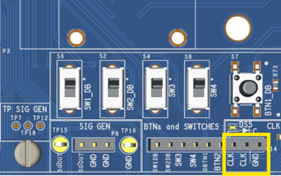
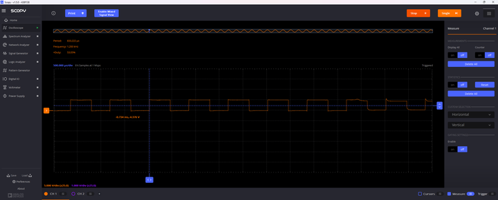
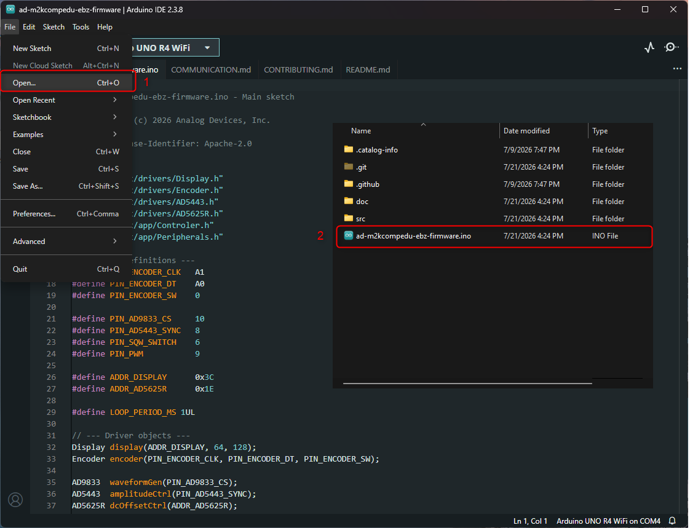
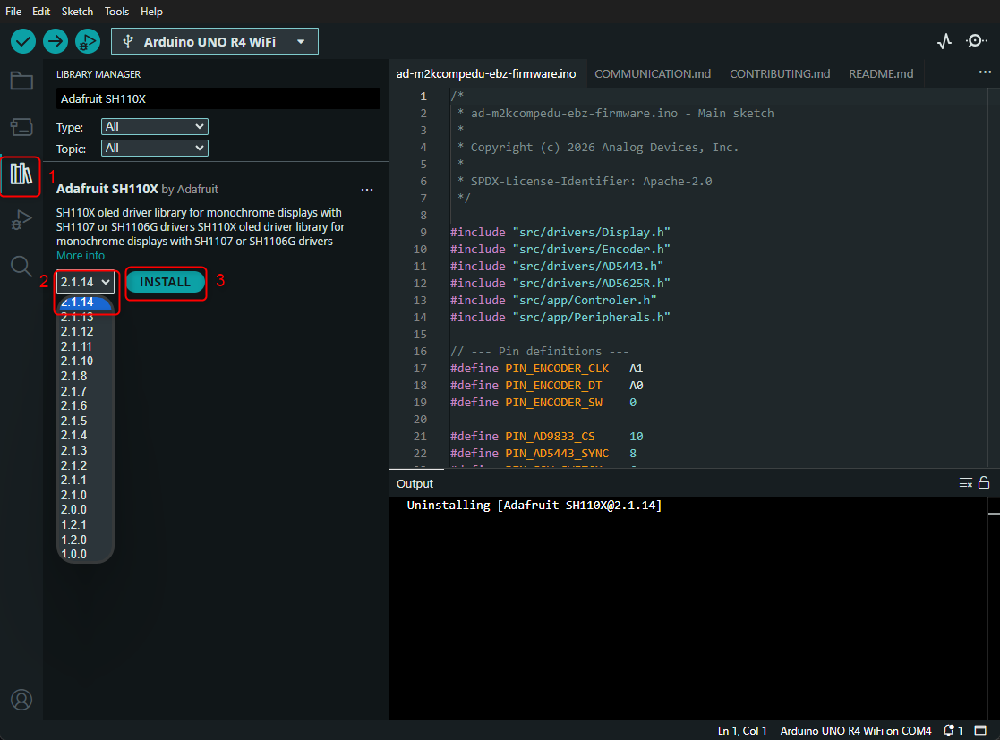
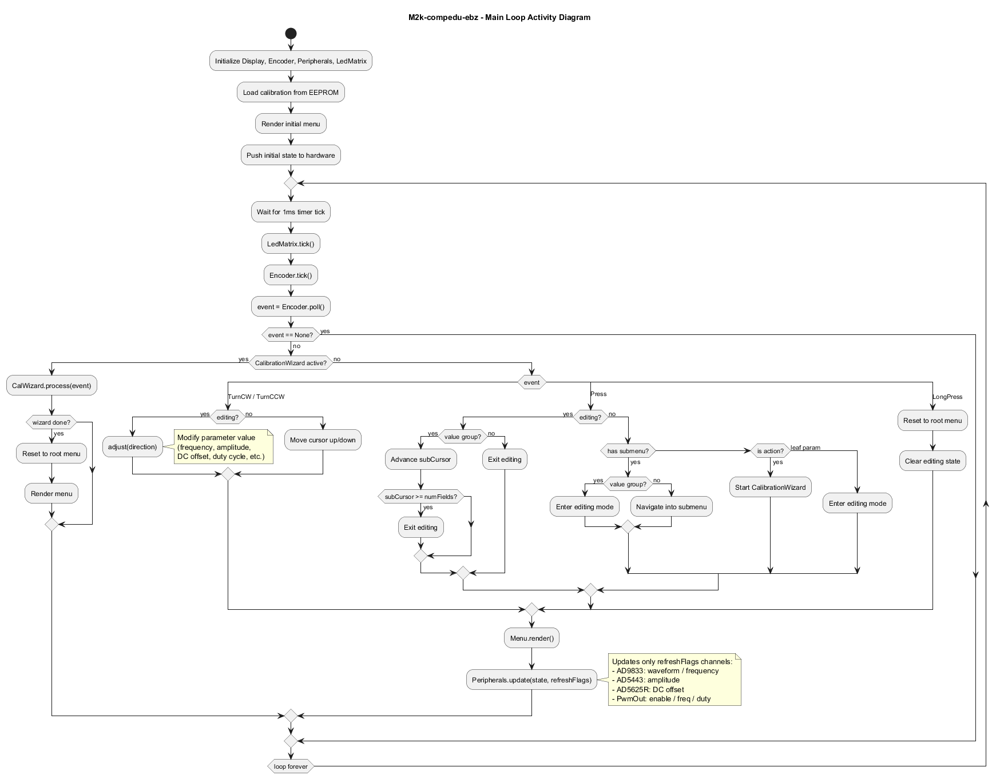
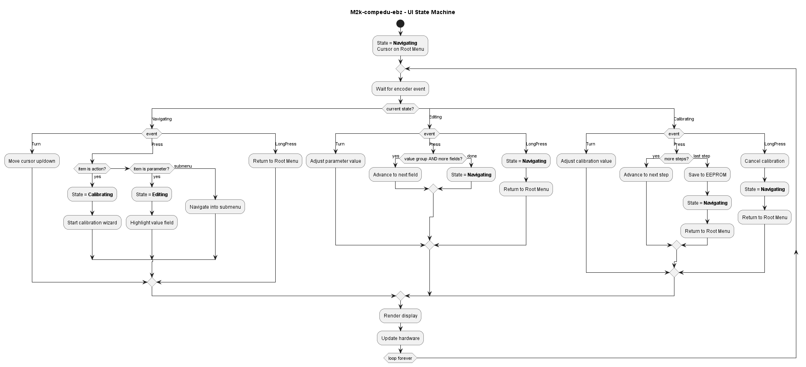

# AD-M2KCOMPEDU-EBZ Firmware

Arduino firmware for the AD-M2KCOMPEDU-EBZ, an educational add-on board for the ADALM2000. It has a signal generator (sine, square, triangle, DC) with adjustable amplitude, frequency, and DC offset, and a PWM generator with adjustable frequency and duty cycle.


# Example Usage

Make sure that your board has the firmware uploaded, if not see Building and Flashing the board section

## Generating a wave

1. Connect the power supply in the USB-C power port of the board and move the Power Swich to the on possition.
2. Using the rotary encoder navigate to Signal Gen -> WaveForm (you can select DC, Sine, Square or Triangle). Then select the peak to peak amplitude frequency and offset

    

3. You can view the resulting waveform by connecting a scope to any of the SGOUT test points or header. As a ground reference you can use any of the test points or headers labled as GND

      
    

## Generating a PWM signal

1. Connect the power supply in the USB-C power port of the board and move the Power Swich to the on possition.
2. Using the rotary encoder navigate to PWN Gen -> PWN Out set to On. Then you can select Frequency and Duty Cycle

    

3. You can view the resulting pwm signal by connecting a scope to any of the CLK labled test points or header. As a ground reference you can use any of the test points or headers labled as GND

       
    

# Building and Flashing the board

## Arduino IDE

The Arduino IDE does not read the build profile, so libraries must be installed
manually via **Sketch > Include Library > Manage Libraries**. Install the exact
versions below for a build that matches the pinned toolchain:

| Library | Version | Purpose |
|---------|---------|---------|
| `Adafruit SH110X` | 2.1.14 | OLED display driver |
| `Adafruit GFX Library` | 1.12.6 | Graphics primitives (used by SH110X) |
| `Adafruit BusIO` | 1.17.4 | I2C/SPI abstraction (dependency of the Adafruit libraries) |
| `AD9833` | 0.4.5 | AD9833 DDS waveform generator driver |


Then:

1. Open `AD-M2KCOMPEDU-EBZ-firmware.ino` in the Arduino IDE

   

2. Install the libraries listed above. In the Library Manager, select the
   package (1), pick the exact version from the dropdown (2), and click
   **Install** (3):

   

3. Install the **Arduino UNO R4 Boards** core, version **1.5.3**, via
   **Tools > Board > Boards Manager** (the version dropdown lets you pick 1.5.3),
   then select **Arduino UNO R4 WiFi** via **Tools > Board**

   

4. Select the correct port via **Tools > Port**
5. Click **Upload** (or Ctrl+U)

## Arduino CLI

The repository includes a `sketch.yaml` build profile that pins the board core
and all library versions. This is the recommended path — it installs the exact
pinned versions into a sketch-local location and requires no manual library
setup.

From the root of the project directory:

```bash
# Compile using the pinned profile (installs the pinned core and libraries)
arduino-cli compile --profile unor4wifi AD-M2KCOMPEDU-EBZ-firmware.ino

# Upload to the connected board
arduino-cli upload --profile unor4wifi --port <port> AD-M2KCOMPEDU-EBZ-firmware.ino
```

Replace `<port>` with the serial port (e.g. `COM3` or `/dev/ttyUSB0`).


UART is configured at **57600 baud** for debug output.

## Flashing the Board

### Before Flashing

Before uploading the firmware, make sure the board is powered and connected:

- **Power supply connected** to the board
- **USB-C cable plugged into the Arduino**
- **Power switch in the ON position**


### After Flashing

Once the upload completes, the firmware boots automatically. You should see:

- The **menu appear on the OLED display**
- The **Analog Devices animation on the UNO R4 LED matrix** — the wedge logo is
  revealed, then the "Analog Devices" text scrolls across


# Further information

## Signal Chain

```
AD9833 (DDS)  -->  AD5443 (MDAC)  -->  OUT_SG
                                        ^
                                        |
                             AD5625R (DC Offset DAC)
```

- **AD9833** generates the base waveform at the set frequency
- **AD5443** MDAC attenuates the AD9833 output by `Data / 4096` (does not generate voltage on its own)
- **AD5625R** generates DC offset via differential pair: `Vout ~ (DAC_A - DAC_B)`

### Amplitude Conversion (V to LSB)

| Waveform | Gain Constant | Example |
|----------|--------------|---------|
| Sine / Triangle | `SinGain_VperLsb = 0.0053311` V/LSB | 1 Vpp = 188 LSB, 5 Vpp = 938 LSB |
| Square | `SqwGain_VperLsb = 0.02914` V/LSB | 1 Vpp = 34 LSB, 5 Vpp = 172 LSB |

### DC Offset Computation

```
DC_LSB = round(DC_voltage / DcOffperLSB) + LSBOFF
DAC_A  = 2048 + DC_LSB / 2
DAC_B  = 2048 - DC_LSB / 2
```

Where `DcOffperLSB = 0.0031640` V/LSB and `LSBOFF` is the calibration correction from EEPROM.

## Software Architecture

The firmware is an Arduino sketch following a **Model-View-Controller** pattern:

```
AD-M2KCOMPEDU-EBZ-firmware.ino                   Entry point (setup + 1ms loop)
src/
  app/
    Controler.cpp/.h        FSM controller, menu tree, state management
    Menu.cpp/.h             Menu rendering with custom markup formatting
    Peripherals.cpp/.h      Hardware abstraction, refreshFlags-based updates
    CalibrationWizard.cpp/.h  Multi-step interactive calibration
  drivers/
    AD5443.cpp/.h           SPI driver for amplitude MDAC
    AD5625R.cpp/.h          I2C driver for DC offset quad-DAC
    Display.cpp/.h          SH1107 OLED driver (via Adafruit_SH110X)
    Encoder.cpp/.h          Rotary encoder with debounce and event detection
    LedMatrix.cpp/.h        UNO R4 12x8 LED matrix startup/idle animation
```

### Main Loop

The main loop runs on a 1 ms tick. Each iteration:

1. Polls the rotary encoder for events
2. Dispatches events to either the CalibrationWizard (if active) or the Controller FSM
3. Renders the menu to the OLED display
4. Pushes changed parameters to hardware (only dirty channels via `refreshFlags[]`)



### UI State Machine

Three top-level states:
- **Navigating** - Browse menus (Root / Submenu), cursor moves with encoder turns
- **Editing** - Adjust a parameter value (single param or multi-field value group)
- **Calibrating** - Multi-step wizard for offset and amplitude calibration



Encoder input mapping:
- **Rotate** - Navigate between menu items (in Navigating) or adjust values (in Editing/Calibrating)
- **Short press** - Enter a sub-menu, enter editing mode, or advance calibration step
- **Long press** - Return to root menu from any state

### Menu Structure

```
Main
 |-- Signal Gen
 |     |-- WaveForm:   OFF / DC / Sine / Square / Triangle
 |     |-- Vampl-pp:   0.0 - 5.0 V (step 0.1 V)
 |     |-- Frequency:  0.1 Hz - 2 MHz (value + order: Hz/KHz/MHz)
 |     |-- DC Offset:  -2.5 V - +2.5 V (step 0.1 V)
 |-- PWM Gen
 |     |-- PWM Out:    ON / OFF
 |     |-- Frequency:  value + order
 |     |-- Duty Cycle: 0 - 100%
 |-- Calibrate
       |-- Calibrate Offset   (multi-step wizard)
       |-- Calibrate Sine Amp (2 steps: 1 Vpp and 10 Vpp)
       |-- Calibrate SQW Amp  (2 steps: 1 Vpp and 10 Vpp)
```

## Calibration System

Three procedures correct for component tolerances. Each is a step-by-step wizard: press advances steps, rotate adjusts values. Results are stored in EEPROM at address `0x10`.

### Offset Calibration

Corrects the DC offset zero-point by adjusting `LSBOFF`.

1. **Press** to start: firmware forces DC mode with DC = 0.0 V. OLED displays: "Connect Voltmeter to Sig Out, Rotate until Vout ~ 0, then Press"
2. **Rotate** to adjust `LSBOFF` until the voltmeter reads 0 V
3. **Press** to store: new `LSBOFF` value saved to EEPROM

### Sine Amplitude Calibration

Corrects sine amplitude gain at two reference points:

1. **Press** to start: firmware sets Sine, 1 KHz, 1 Vpp, DC = 0 V
2. **Rotate** to adjust `LsbCal_SineAmp1V` until scope reads exactly 1 Vpp
3. **Press** to advance: amplitude changes to target 10 Vpp
4. **Rotate** to adjust `LsbCal_SineAmp10V` until scope reads exactly 10 Vpp
5. **Press** to store

### Square Wave Amplitude Calibration

Same procedure as sine calibration, but uses `SqwGain_VperLsb` and adjusts `LsbCal_SqWAmp1V` / `LsbCal_SqWAmp10V`.
