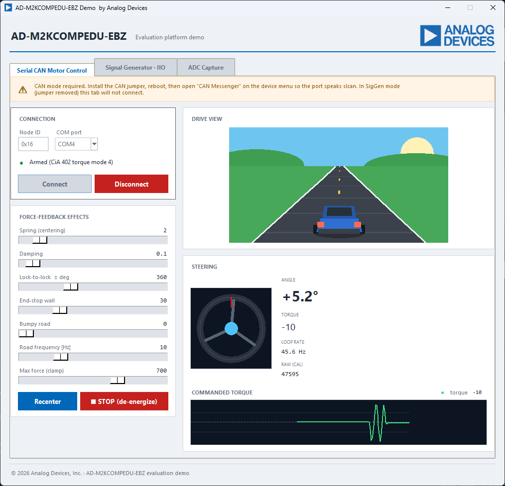
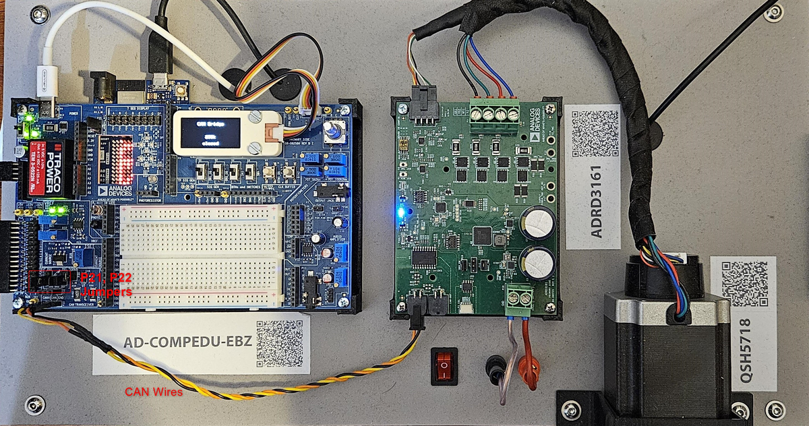
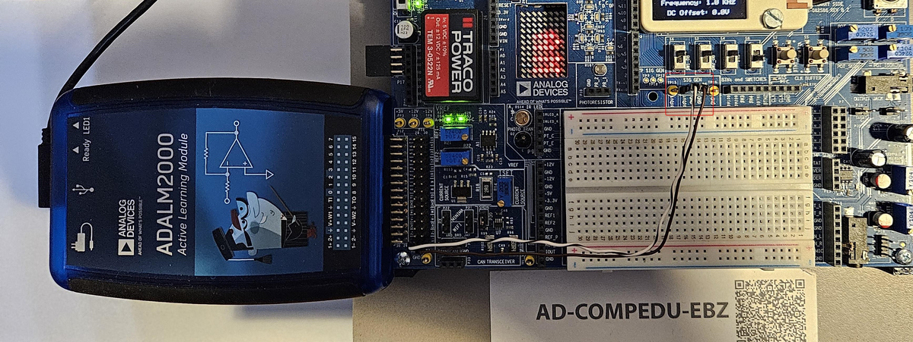
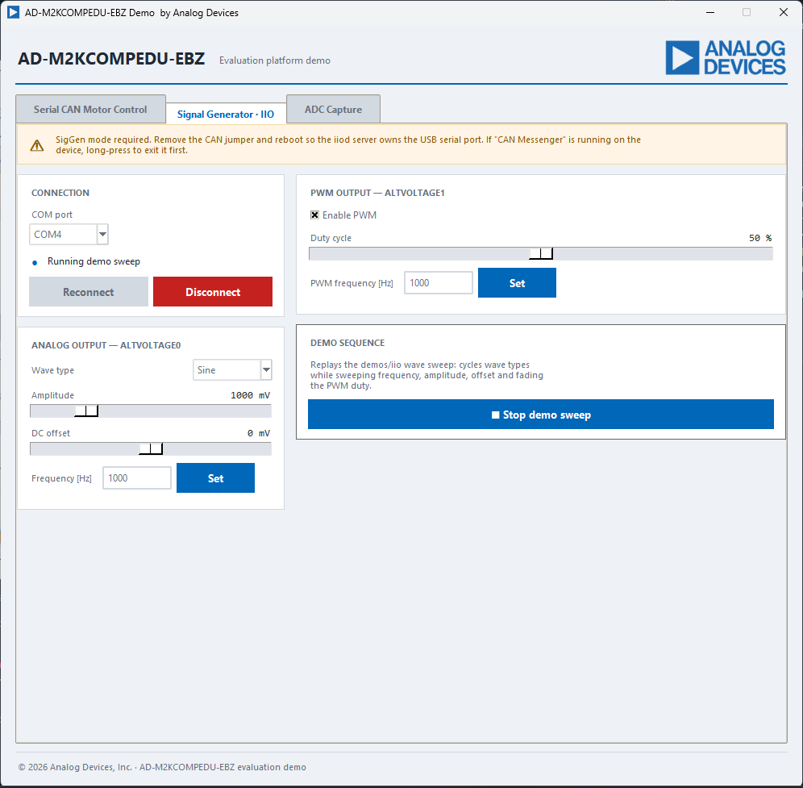
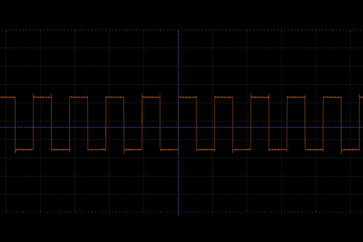
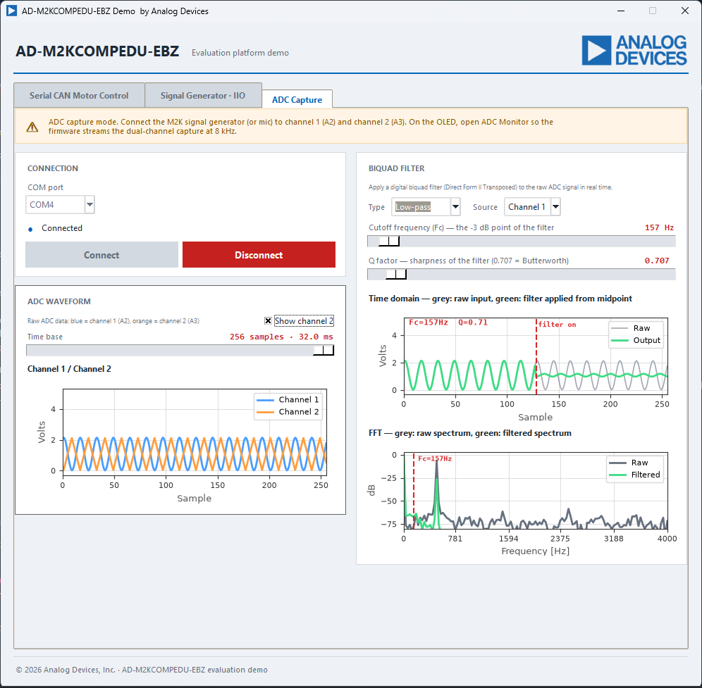

# AD-M2KCOMPEDU-EBZ Demo Panel

A single Tkinter application that exercises everything the board can do over its
USB serial port, one tab per feature:

| Tab | What it does |
|-----|--------------|
| Serial CAN Motor Control | Force-feedback steering wheel on an ADRD3161 motor drive |
| Signal Generator · IIO | Live control of the signal generator and PWM over libiio |
| ADC Capture | Oscilloscope-style view of the A2/A3 inputs with a real-time digital filter |

All three tabs share the one USB serial port, so only one can be connected at a
time — connecting a tab automatically disconnects the others. A banner at the
top of each tab reminds you which jumpers/mode it needs.

## Running it

```bash
python ebz_demo.py                  # defaults: motor node 0x16, port COM4
```

Requirements: Python 3 with `tkinter`, plus `matplotlib` and `pyserial`.
Each tab's bus library is imported lazily, so the panel launches without them
and simply reports what is missing when you press Connect:

- **Motor tab**: `canopen` (which pulls in `python-can`)
- **IIO tab**: `pylibiio`

All bus traffic runs on worker threads, so the UI stays responsive, and every
output is driven to a safe state (torque zeroed, generator off, PWM disabled)
when a tab disconnects or the window closes.

## Serial CAN Motor Control

A force-feedback steering wheel: the board acts as a USB-to-CAN (slcan) bridge,
and the panel drives a TMC9660-based ADRD3161 drive with a QSH5718 motor over
CANopen in CiA 402 torque mode. Turn the shaft and the on-screen wheel turns
with it; the panel pushes back with a configurable force stack.



### Hardware setup

1. Install the two CAN jumpers (P21 and P22) and reboot the board, then open **CAN
   Messenger** on the OLED so the serial port speaks slcan — see the
   [CAN Messenger](../README.md#can-messenger) section of the main README
2. Wire the board's CAN header to the ADRD3161 CAN bus and power the drive



### How it works

On Connect, a worker thread opens the slcan channel (500 kbit/s), arms the
drive into CiA 402 *Profile Torque* mode with a manual controlword sequence
over SDO, and keeps the node in NMT PRE-OPERATIONAL so TPDO traffic doesn't
flood the serial bridge. It then runs a fast loop (~45 Hz, bounded by slcan
SDO latency): read the shaft position, derive velocity, compute a torque, and
command it as *Target torque*.

The torque is the sum of a few simple effects, each with its own slider:

- **Spring** — centering force proportional to the angle from center
- **Damping** — opposes velocity; automatically floored in proportion to the
  spring so a stiff spring can't be run undamped into oscillation
- **Lock-to-lock / End-stop wall** — a steep extra wall past the ± lock angle
- **Bumpy road** — a fixed-amplitude sinusoidal buzz you feel at any speed
- **Max force** — user clamp on the commanded torque

The torque engine and CANopen bring-up live in
[motor_control/ffb.py](motor_control/ffb.py); the drive's parameter set and
provisioning tool are in
[motor_control/motor_driver_config/](motor_control/motor_driver_config/).

## Signal Generator · IIO

Interactive control of the board's signal generator (`altvoltage0`) and PWM
output (`altvoltage1`) through the firmware's IIOD server, using the libiio
serial backend — the GUI counterpart of poking the attributes with `iio_attr`.

### Hardware setup

1. Remove the CAN jumpers (P21/P22) so the IIOD server owns the serial port
   (if CAN Messenger is open on the OLED, long-press to exit it first) — see the
   [Remote control over IIO](../README.md#remote-control-over-iio) section of the
   main README
2. Connect an ADALM2000 to the signal generator output:
   - ADALM2000 `1+` → `SGOUT`
   - ADALM2000 `1-` → `GND`



### The panel and Scopy



Use Scopy's [Oscilloscope](https://wiki.analog.com/university/tools/m2k/scopy/oscilloscope)
instrument to view the generated signal while you move the panel's controls.
Pressing **Run demo sweep** should show a wave sweep on the scope:



### How it works

On Connect, a worker thread opens a libiio context on
`serial:<port>,921600,8n1` and finds the `m2kcompedu-ebz` device. Every control
maps 1:1 to an IIO channel attribute:

- **Wave type / Amplitude / DC offset / Frequency** → `altvoltage0`
  `wavetype`, `amplitude`, `offset`, `frequency`
- **Enable / Duty cycle / PWM frequency** → `altvoltage1` `enable`,
  `duty_cycle`, `frequency`

Slider moves are queued to the worker and written on its thread, so dragging
stays smooth regardless of serial latency. **Run demo sweep** plays a canned
animation — it cycles Sine/Square/Triangle while sweeping frequency, amplitude
and offset and fading the PWM duty up and down — and restores your manual
settings when stopped. On disconnect the generator is switched off and the PWM
disabled.

The libiio worker lives in [iio/siggen.py](iio/siggen.py).

## ADC Capture

A two-channel scope view of the board's ADC inputs: channel 1 (A2) and
channel 2 (A3), sampled by the firmware at 8 kHz / 14-bit, with an optional
real-time biquad filter and FFT.



### Hardware setup

1. Connect an ADALM2000's waveform generator outputs to the ADC inputs:
   - ADALM2000 `W1` → `A2`
   - ADALM2000 `W2` → `A3`
   - ADALM2000 `GND` → `GND`
2. Use Scopy's [Signal Generator](https://wiki.analog.com/university/tools/m2k/scopy/siggen)
   instrument to drive the two channels — for example a sine on channel 1 and a
   triangle on channel 2
3. On the OLED, open **ADC Monitor** — this makes the firmware stream capture
   blocks over the serial port; see the [ADC Capture](../README.md#adc-capture)
   section of the main README

### How it works

The firmware emits each completed 256-sample block as a binary frame
(`0xAA 0x55` sync, channel count, then little-endian int16 samples — see the
[ADC Capture section](../README.md#adc-capture) of the main README). A reader
thread syncs to the frame markers, converts the samples to volts, and hands
complete blocks to the UI, which redraws at most ~6 times a second.

- **ADC Waveform** card: raw channel 1 (blue) and channel 2 (orange) traces, with
  a time-base slider from 16 samples (2 ms) up to the full 256-sample block
  (32 ms)
- **Biquad Filter** card: applies a Direct Form II Transposed biquad to either
  channel in real time. Pick the type (low/high/band-pass, band-stop, peak,
  shelves, one-pole), cutoff frequency, Q, and gain where applicable. The time
  plot shows the raw signal with the filter engaged from the midpoint of the
  window, so you can see before/after in one trace; the FFT plot shows the raw
  vs. filtered spectrum with the cutoff marked

The serial reader is [adc_capture/worker.py](adc_capture/worker.py); the filter
coefficients and FFT are plain-Python ports in
[adc_capture/dsp.py](adc_capture/dsp.py).
